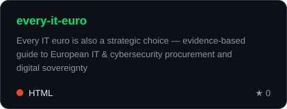
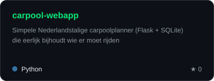
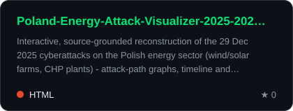
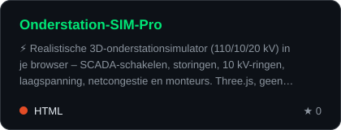
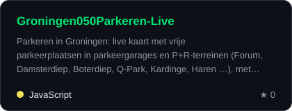
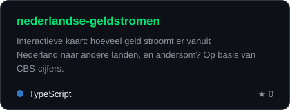
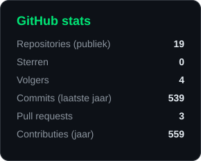
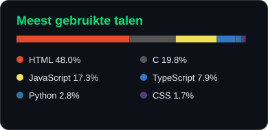
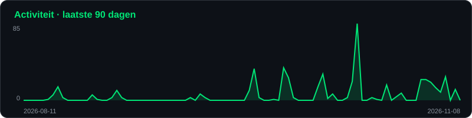
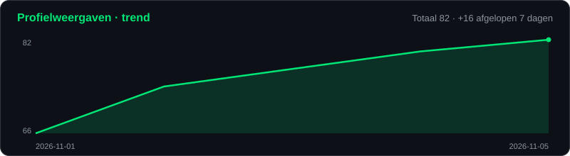

 

  

---

## 🧰 Tech & tools

## ⭐ Uitgelicht

## 🚀 Alle recente projecten

<!-- PROJECTS:START -->
| Project | Wat is het |
|---|---|
| [carpool-webapp](https://github.com/ProAdmin007/carpool-webapp) | Simpele Nederlandstalige carpoolplanner (Flask + SQLite) die eerlijk bijhoudt wie er moet rijden |
| [linkedin-saved-posts-exporter](https://github.com/ProAdmin007/linkedin-saved-posts-exporter) | Chrome extension to export your saved LinkedIn posts to CSV or JSON — free, open source, 100% local, no servers. |
| [Poland-Energy-Attack-Visualizer-2025-2026](https://github.com/ProAdmin007/Poland-Energy-Attack-Visualizer-2025-2026) | Interactive, source-grounded reconstruction of the 29 Dec 2025 cyberattacks on the Polish energy sector (wind/solar farms, CHP plants) - attack-path graphs, timeline and filters, built from CERT Polska's public reports. FastAPI + vanilla JS + D3. |
| [Groningen050Parkeren-Live](https://github.com/ProAdmin007/Groningen050Parkeren-Live) | Parkeren in Groningen: live kaart met vrije parkeerplaatsen in parkeergarages en P+R-terreinen (Forum, Damsterdiep, Boterdiep, Q-Park, Kardinge, Haren …), met trendanalyse. Open data, React + Leaflet. |
| [nederlandse-geldstromen](https://github.com/ProAdmin007/nederlandse-geldstromen) | Interactieve kaart: hoeveel geld stroomt er vanuit Nederland naar andere landen, en andersom? Op basis van CBS-cijfers. |
| [Onderstation-SIM-Pro](https://github.com/ProAdmin007/Onderstation-SIM-Pro) | ⚡ Realistische 3D-onderstationsimulator (110/10/20 kV) in je browser – SCADA-schakelen, storingen, 10 kV-ringen, laagspanning, netcongestie en monteurs. Three.js, geen installatie. |
| [Substation-simulator-61850](https://github.com/ProAdmin007/Substation-simulator-61850) | A substation engineering focused browser game. |
| [HA-Custom-Washing-Machine-Card](https://github.com/ProAdmin007/HA-Custom-Washing-Machine-Card) | - |
<!-- PROJECTS:END -->

## 📊 GitHub stats

